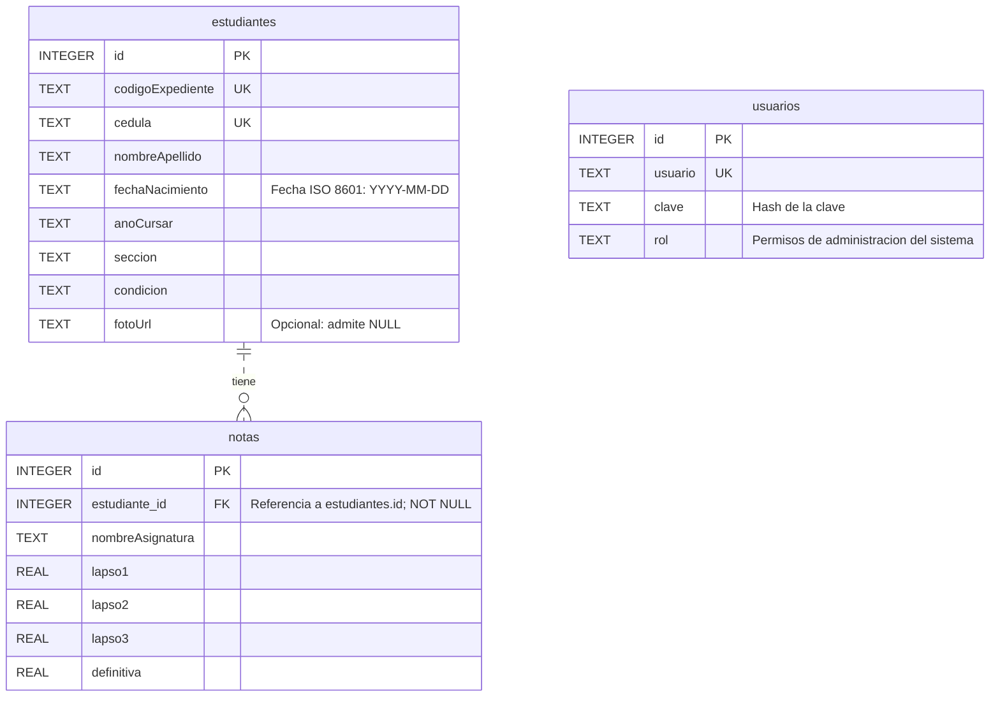

# 🎓 StudioCT — Sistema Tecnológico para el Control, Seguimiento y Registro Estudiantil
> **Liceo "Elisa Pulgar de Ramírez"**

El presente Trabajo de Grado documenta la implantación de **StudioCT**, un Sistema Tecnológico para el Control, Seguimiento y Registro estudiantil desarrollado para el **Liceo "Elisa Pulgar de Ramírez"**. 

El proyecto parte del diseño elaborado en la fase de Técnico Superior Universitario (2024) y responde a una necesidad diagnosticada junto con la institución: la falta de optimización de los procesos, pérdida y desorganización de la información en el departamento de control de estudio del Liceo "Elisa Pulgar de Ramírez", afectando de manera negativa a sus regidores y alumnos. 

El trabajo se enmarca en la **Investigación Acción Participativa (IAP)**, y el software se desarrolló bajo un **método Iterativo e Incremental**, usando herramientas como Git y GitHub para el control de versiones y mejoras. Se diseñó una arquitectura cliente-servidor con un rol específico (Administrador). Se levantaron los requisitos funcionales y operativos orientados a la gestión académica de educación media general, estableciendo como premisa principal una solución liviana, autónoma y totalmente compatible con entornos de bajos recursos.

Se diseñó una arquitectura de software basada en un modelo de **Aplicación de Página Única (SPA)** conectada a un servidor backend priorizando la portabilidad y descartando la dependencia de servicios de bases de datos externos complejos. Para ello, se estructuró un sistema de almacenamiento relacional basado en archivos que garantiza persistencia e integridad referencial de forma local.

Se modeló el esquema de datos relacional estructurado en dos entidades principales vinculadas por claves foráneas: la ficha integral del estudiante —que incluye control de datos personales, condición de ingreso, códigos de expediente únicos y gestión multimedia de fotografías de perfil— y la tabla de calificaciones, configurada bajo el pensum oficial de nueve asignaturas distribuidas en tres lapsos evaluativos.

Por último, se construyeron e integraron los módulos funcionales operativos:
* Un **panel de métricas y estadísticas** para el monitoreo en tiempo real de la matrícula y el rendimiento general del plantel.
* Un **módulo de gestión de estudiantes (CRUD)** dotado de filtros multicriterio avanzados por cédula, año y sección.
* Una **matriz interactiva de calificaciones** con validaciones y cálculo automático de notas definitivas.
* Un **módulo de reportes oficiales** que genera el boletín informativo con diseño institucional y formato A4, optimizado para la exportación e impresión directa en PDF.

---

## 📐 Arquitectura y Estructura de la Base de Datos (Diagrama ER)

El sistema utiliza una base de datos relacional en SQLite gestionada mediante la arquitectura modular `tabla-model`. A continuación se presenta el modelo Entidad-Relación formal del sistema:



---

## 🚀 Características Técnicas y Mejoras Implementadas

### 1. 🔐 Autenticación y Cierre de Sesión Seguro
* **Protección Frontend (Client-Side Guard):** Script de verificación inmediata en el `<head>` de `index.html` que comprueba si existe la sesión activa (`auth_liceo`) en el `localStorage`. Si se intenta acceder sin autenticación, redirige automáticamente a `login.html`.
* **Controlador de Autenticación Backend (`authController.js`):** Validación limpia de credenciales contra la base de datos SQLite.
* **Cierre de Sesión:** Botón **"Salir"** integrado en el pie del panel lateral (`sidebar`) que remueve la sesión local y redirige al login.

### 2. ⚡ Auto-Inicialización del Servidor (`Server Bootstrap`)
* **Modelo Basado en `tabla-model`:** Arquitectura modular desacoplada (`usuarioModel.js`) que maneja las operaciones SQLite (`all`, `insert`).
* **Auto-Creación del Admin:** Al iniciar el servidor (`node server.js`), una función asíncrona comprueba si existen usuarios creados. Si la tabla está vacía, inserta automáticamente las credenciales por defecto (`admin` / `1234`).

### 3. 🔍 Búsqueda e Interactivación Multicriterio en Tiempo Real
* **Filtros Combinados:** Implementados con el evento `oninput` y `onchange` para filtrado en tiempo real.
* **Integración Global:** Funciona de forma unificada en la **Matrícula de Estudiantes (CRUD)**, **Carga de Calificaciones** y **Generación de Boletines Escolares**, permitiendo filtrar por coincidencias de texto (Cédula, Nombre o Expediente) combinado con **Año** y **Sección**.

### 4. 📜 Generador de Boletines Oficiales (Formato A4)
* **Maquetación Institucional:** Formato adaptado con los membretes oficiales del MPPE.
* **Optimización para Impresión (`@media print`):** Estilos CSS que ocultan la barra de navegación, botones y filtros al imprimir o guardar directamente en PDF.

---

## 🛠️ Tecnologías Utilizadas

* **Backend:** Node.js, Express.js.
* **Base de Datos:** SQLite3 (con patrón `tabla-model`).
* **Frontend:** HTML5, CSS3, JavaScript Vanilla (Arquitectura SPA).
* **Gestión Multimedia:** Multer (carga de fotografías de perfil).
* **Control de Versiones & Diagramación:** Git, GitHub, Mermaid.js.

---

## ⚙️ Instrucciones de Instalación y Ejecución Local

1. **Clonar el repositorio:**
   ```bash
   git clone https://github.com/tu-usuario/studio-ct.git
   cd studio-ct
   ```

2. **Instalar dependencias del proyecto:**
   ```bash
   npm install
   ```

3. **Iniciar el servidor:**
   ```bash
   node server.js
   ```

4. **Acceder a la aplicación:**
   Abre tu navegador web e ingresa a `http://localhost:3000`. Usa las credenciales por defecto:
   * **Usuario:** `admin`
   * **Contraseña:** `1234`
